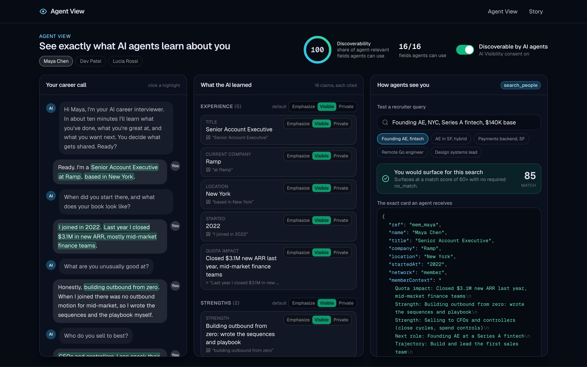
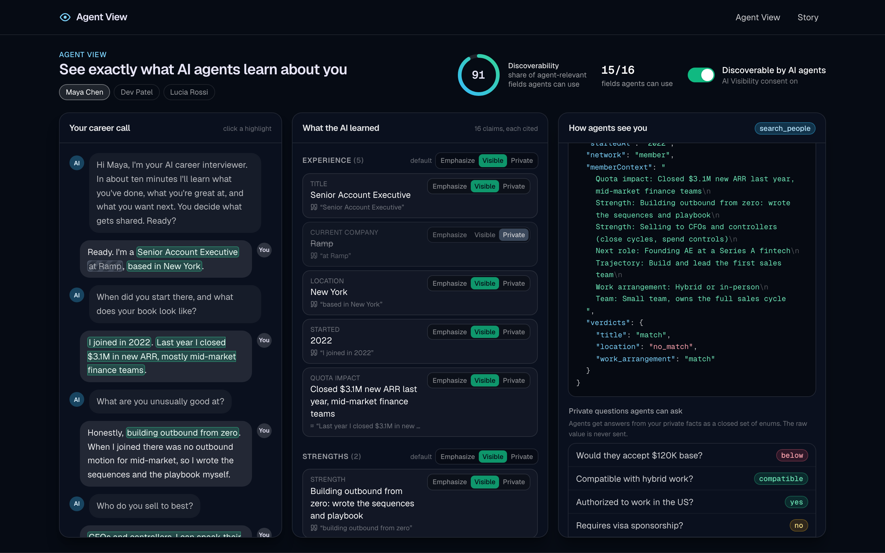
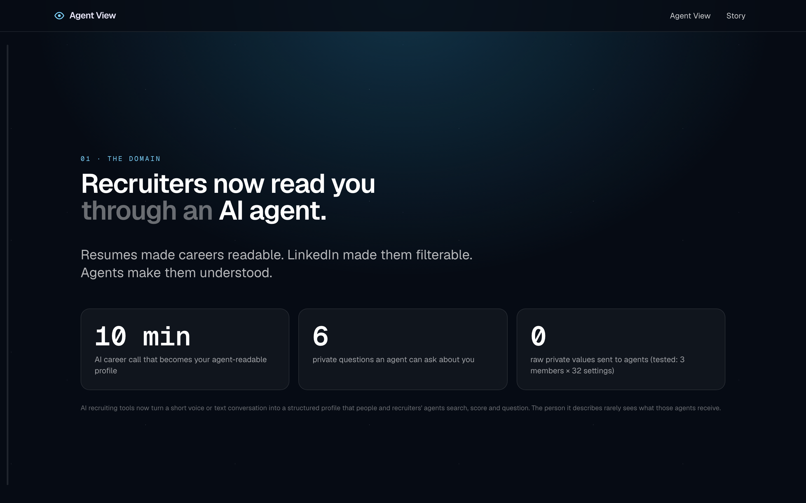
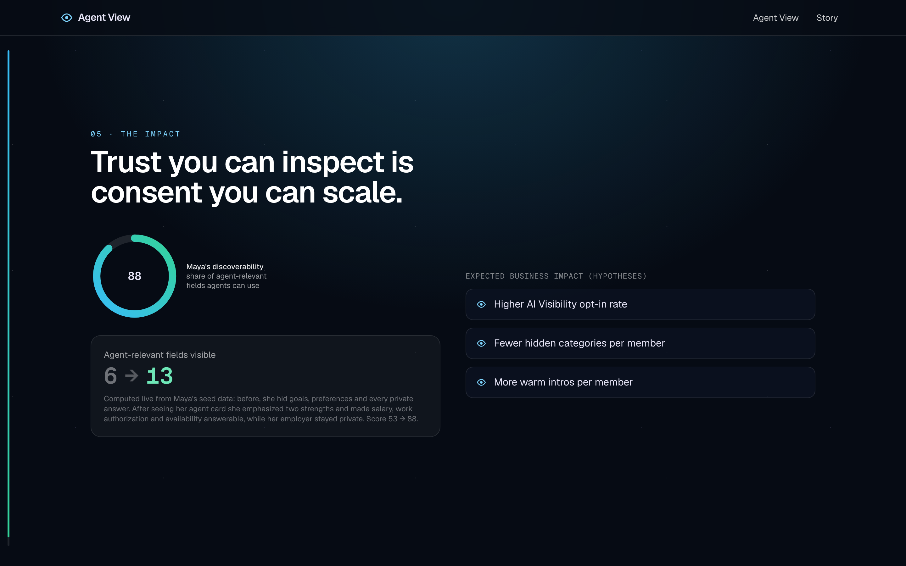

# Agent View: see exactly what AI agents learn about you

An independent open-source project about **candidate profiles that AI recruiting agents read**.



## The problem

AI recruiting tools increasingly replace the resume with a short voice or text conversation. An AI interviewer asks what you have done, what you are great at, what you want next and what you want kept private, then turns that call into a structured profile. Recruiters, and more and more often recruiters' **agents** (through MCP-style tools such as `search_people` and private-question answering), search, score and question that profile.

That arrangement only works on trust, and the trust is blind. Consent is usually one abstract "AI visibility" switch plus a few category toggles. The candidate cannot see the card a recruiter's agent actually receives, or which sentence of their call produced each claim about them. Users of popular tools in this space say so publicly: job-seeker forums ask whether these AI career calls are "a scam" or "just a database they are building". Each person who hides a category or withholds consent drops out of agent search, so the blindness costs the platform its main asset: consented candidate context.

## The feature

`/agent-view` is a candidate-facing page with three panes:

1. **Evidence-linked profile.** Every extracted claim cites the exact transcript span it came from. Clicking a claim scrolls to its quote in the call and pulses it.
2. **Visibility controls.** Each claim and each category gets Emphasize / Visible / Private. Private facts also get **Answerable / Hidden**, so salary stays private but agents can still ask about it. A master **Discoverable by AI agents** switch controls consent.
3. **"How agents see you" simulator.** Pick or type a recruiter query (for example "Founding AE, NYC, Series A fintech, $140K base"). You see whether you would surface and your match score, the **exact MCP-style card JSON** with redactions shown as `[private]` pills, and the answers to a closed set of private-predicate questions (`meets / below / yes / no / compatible / incompatible / unknown / blocked`). These answers never include the raw value.

Every toggle updates the card, the match and the answers immediately. A discoverability ring shows how much agent-relevant context you are sharing.

## Why this feature

Two candidates made the shortlist:

- **A. Explain recruiter match scores** (demand side): "why this fit" evidence cards. Useful, but recruiter-side tools in this space already ship rubric scoring with cited criteria.
- **B. Agent View for candidates** (supply side): chosen. Consented candidate context is what every agent search runs on, so it bounds the whole marketplace. Agent View turns the "you stay in control" promise into something a candidate can check, field by field, before they decide how much to share. It plugs into the contract shapes agents already call (search card, `memberContext`, a closed predicate catalog, visibility categories) instead of inventing new ones.

`/story` is an animated explainer covering the domain, the pain, the decision, a before/after diagram, and the measured impact. It uses Maya's real seed numbers: discoverability goes from **53 to 88** and agent-usable fields from **6 to 13**, both computed by the same `discoverabilityScore` the app uses.

## Measured impact (seed data, same code the app runs)

| Metric | Before | After |
|---|---|---|
| Discoverability score (`discoverabilityScore`) | 53 | 88 |
| Agent-usable fields | 6 | 13 |
| Raw private values leaked into any agent card | 0 | 0 (3 members x 32 toggle combinations) |

## Screenshots

| Agent View | Agent simulator |
|---|---|
|  |  |
| **Story** | **Impact** |
|  |  |

## Run

```bash
pnpm i
pnpm dev            # http://localhost:3000/story and /agent-view
pnpm test           # 65 tests: unit, PGlite integration, API, React Testing Library
pnpm typecheck && pnpm lint && pnpm build
```

Call the agent endpoint the way a recruiter agent would:

```bash
curl "http://localhost:3000/api/mcp/search?member=maya&q=Founding%20AE%2C%20NYC%2C%20Series%20A%20fintech%2C%20%24140K%20base"
# -> { ref, query, card: { ref, name, title, company, location, startedAt, network: "member", memberContext, verdicts },
#      match: { surfaces, score, verdicts, matchedClaimIds }, predicates: { salary_min: "meets", ... } }
```

Turn off consent in the UI and the same call returns `{ "withheld": "consent" }` with no card.

Data persists to `./.pglite` in dev. Set `PGLITE_DIR=memory` for an ephemeral database.

## Stack

| Choice | Why |
|---|---|
| Next.js 15 App Router, React 19, TypeScript strict | server components for the page, a server action for settings, a route handler for the agent endpoint |
| Geist font | clean UI and monospace for card JSON |
| Tailwind, Radix primitives, lucide, sonner | the usual pairing with the next/font Geist setup |
| PostgreSQL via **PGlite** | real Postgres compiled to WASM and running in-process, so no credentials are needed |
| `/api/mcp/...` route handler | where an MCP-over-HTTP server would expose the same card |
| motion (`motion/react`) | all animation, with `useReducedMotion` fallbacks |
| zod, Vitest, Testing Library | validation and tests |

Two parts are stand-ins:
- **LLM extraction** is mocked behind `ProfileExtractor`. `SeededExtractor` is the only implementation, and `src/lib/extract/extractor.ts` describes where a tool-calling extractor would plug in.
- **Postgres** is PGlite behind the `ProfileRepository` interface. `InMemoryProfileRepository` implements the same interface for unit tests.

## How it maps to an MCP-style agent contract

- **Card shape:** `toAgentCard` emits the `search_people` member card keys (`ref, name, title, company, location, startedAt, network: "member", memberContext, verdicts`).
- **`memberContext`:** built only from visible and emphasized claims, with emphasized claims first.
- **Closed predicate catalog:** `salary_min`, `us_work_authorization`, `sponsorship_required`, `job_search_availability`, `relocation_willingness`, `work_arrangement`. Answers are enums only.
- **AI visibility consent:** with consent off, the projection is `{ withheld: "consent" }` and every predicate answers `blocked`.

## Guarantees backed by tests

- No private claim value ever appears in `JSON.stringify(projection)`. This is checked for 3 members × all 2⁵ category-toggle combinations.
- Hiding a claim can turn a verdict from `match` into `unknown`, but never into `no_match`.
- Predicates never return a raw value.
- Every claim's `quote` equals `transcript.turns[turnId].text.slice(start, end)`.
- The numbers on the story page equal `discoverabilityScore` applied to the seed data.

## Code layout

```
src/lib/        types (zod), visibility, card, query, predicates, score, search, db/ (schema.sql, PGlite + memory repos)
src/seed/       3 members, transcripts, evidence-linked claims, 5 sample queries, story before/after settings
src/app/        agent-view (server page + client shell + server action), story, api/mcp/search
src/components/ transcript, claims, visibility control, JSON card, query box, predicates, score ring, story/*
tests/          9 Vitest files
```

## Limitations

- Seed data only: 3 members and hand-authored extraction.
- Query parsing is rule-based (title and city dictionaries, amounts, arrangement words), and matching uses deterministic token and synonym overlap.
- There is no auth or multi-tenancy, and the MCP transport isn't implemented. The JSON route only mirrors the card shape.

## Built with Claude Code

This was designed, test-driven and built end to end with [Claude Code](https://claude.com/claude-code). It is an independent project. The repo contains no secrets; `.env.example` documents an unused `ANTHROPIC_API_KEY`.
